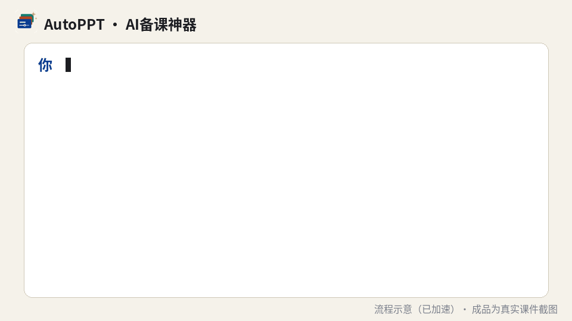

<p align="center"></p>

<h1 align="center">AutoPPT · AI备课神器</h1>

<p align="center">
  <b>One sentence → a full week of beautiful, interactive HTML teaching decks.</b><br>
  No coding, no complex design — lesson prep made simple.<br>
  <b>Zero coding · Any subject · Interactive decks</b>
</p>

<p align="center"><br>
<sub>Demo: one prompt → design doc → three decks, real code runs, self-checks → result (process sped up; results are real screenshots)</sub></p>

AutoPPT ("AI备课神器", AI lesson-prep assistant) is an **agent skill + deck engine** for **Claude Code and OpenAI Codex** (developed with Claude Code; the Codex entry shares the same engine and scripts). Give it a course topic (or a syllabus); the agent delivers a full week you can teach from directly:

- three Reveal.js decks — two lectures + one lab (≈45 min / ≈20 slides each, 1920×1080, offline);
- **full speaker notes on every slide** (time, goal, script, questions, pitfalls, transition) — press `S` for the speaker view;
- **interactive demos that compute for real in the browser**, cross-checked against Python;
- **runnable lab code**: code, outputs and Jupyter notebooks all come from one real, self-checked run;
- an auto-generated **student version**, a **teacher guide** with a minute-by-minute schedule, a student setup guide, fact sources and image credits.

## How it works
0. **Intake** — the agent reads your syllabus / textbook / old slides, then asks a few multiple-choice questions (students, weeks, weekly topics, lab type, image policy, style).
1. **Course content design** — a week-by-week outline you confirm before anything is built.
2. **Weekly design doc** — storyline, slide-by-slide plan, interactions, fact-check list; you edit it.
3. **Build** — data & lab scripts (really run) → **images** (draw → compute → your assets → open-licensed libraries like Wikimedia Commons / Openverse, sources registered automatically → labelled AI illustrations) → components → slides & notes → build.
4. **Verify & deliver** — smoke test, overlap audit, screenshots reviewed by eye.

## Three styles
<p align="center"></p>

| Style | Look | Good for |
|---|---|---|
| **A Academic journal** (`academic`, default) | warm paper, serif headlines, sentence titles + evidence | theory-heavy courses |
| **B Dark stage** (`stage`) | dark cover/section slides, giant years, big statements; light content slides | storytelling, history, public talks |
| **C Geometric blocks** (`blocks`) | deep-blue blocks, orange dots, grid layouts, bold sans | engineering, design, modern feel |

All three share the same slide types, components and notes format; switching style means swapping one CSS file.

## Why
PowerPoint decks are slow to make, barely interactive, and their code screenshots drift away from what students actually get. AutoPPT keeps everything as plain text (HTML/CSS/JS + Python scripts), so it is diff-able, rebuildable and verifiable. It grew out of a real 16-week first-year AI course at Fudan University (Fall 2026); in that course the teacher spent **about half an hour per week** reading and editing the design doc and confirming a few things, while the agent did the rest and checked its own work. Week 1 is included as a reference example (`examples/week01/`, Chinese).

## Quick start
```bash
git clone https://github.com/<you>/autoppt.git
cd autoppt
python3 install.py --agent claude     # Claude Code → ~/.claude/skills/autoppt
python3 install.py --agent codex      # OpenAI Codex → ~/.agents/skills/autoppt (invoke with $autoppt)
cd examples/week01 && python3 start.py   # open the example; press S for notes
```
Then, in your course folder, tell your agent:
> Build week 1 of my course: *Introduction to AI*, for first-year students with no coding background, in the "academic" style.

For a whole course: give it your syllabus, let it set up the outline and conventions memo, pick a style, review each week's design doc, then say "go".

Requirements: an AI coding agent (you don't need to code yourself); Python 3.9+; Node 18+ with Playwright for checks (`npm i -g playwright && npx playwright install chromium`); optional `fonttools` + Noto CJK fonts.

## For agents
Claude Code: [`skills/autoppt/SKILL.md`](skills/autoppt/SKILL.md). Codex: [`skills/autoppt/SKILL.codex.md`](skills/autoppt/SKILL.codex.md) + [`references/codex.md`](skills/autoppt/references/codex.md). See also [AGENTS.md](AGENTS.md).

## License
Code: MIT. Example teaching content: CC BY-NC-SA 4.0. Third-party: reveal.js (MIT), Noto CJK subsets (OFL 1.1). Classroom-only images from the original course were replaced with placeholders.
